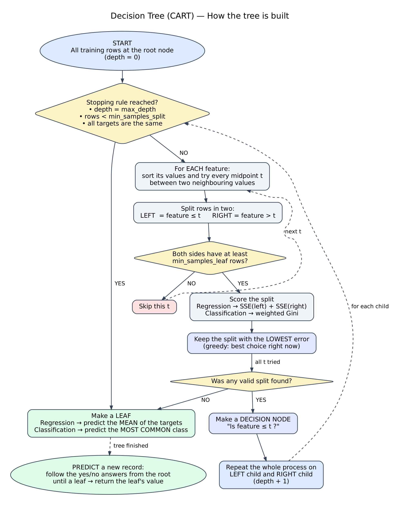

# Decision Tree Algorithm — Pseudocode and Flowchart

This is a formal version of the decision tree (CART) algorithm used in this workshop, for the team presentation. It follows the coaching notebook (`notebooks/Decision_Tree_Regression_Algorithm_Coaching.ipynb`).

## Flowchart



## Pseudocode

```text
BUILD_TREE(rows, depth):
    IF depth = max_depth
       OR number_of_rows < min_samples_split
       OR all targets in rows are equal:
        RETURN Leaf(prediction = MEAN(targets))          # regression
                                                         # classification: MOST_COMMON(labels)

    best_split = NONE
    best_error = INFINITY

    FOR each feature:
        values = SORTED(DISTINCT(feature values in rows))
        FOR each midpoint t between two neighbouring values:
            left  = rows where feature <= t
            right = rows where feature >  t
            IF size(left) < min_samples_leaf OR size(right) < min_samples_leaf:
                SKIP this t
            error = SSE(left) + SSE(right)                # classification: weighted Gini
            IF error < best_error:
                best_split = (feature, t)
                best_error = error

    IF best_split = NONE:
        RETURN Leaf(prediction = MEAN(targets))

    RETURN DecisionNode(question = "feature <= t ?",
                        left  = BUILD_TREE(left,  depth + 1),
                        right = BUILD_TREE(right, depth + 1))


PREDICT(node, record):
    WHILE node is not a Leaf:
        IF record[node.feature] <= node.t:
            node = node.left
        ELSE:
            node = node.right
    RETURN node.prediction
```

## Key terms

| Term | Meaning |
|---|---|
| SSE (sum of squared errors) | For each side: add up (value − side mean)². Lower SSE means a cleaner split. |
| Weighted Gini | Classification impurity of each side, weighted by the number of rows on that side. 0 means a pure leaf. |
| Greedy | The tree picks the best split at each step; it does not search for the globally best whole tree. |
| `max_depth`, `min_samples_split`, `min_samples_leaf` | Stopping rules that control model complexity and overfitting. |
